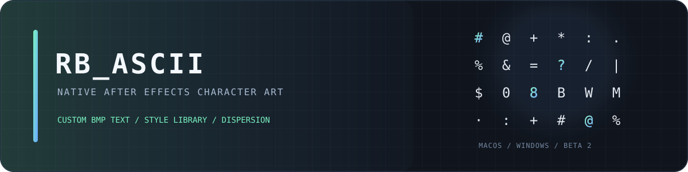

# RB_ASCII Native · 0.4.4 beta 2

**After Effects 的原生字符化效果插件**：用自定义 BMP 文本，或由形状、文字、图片、预合成组成的图层样式库，把素材转换为带调色和动态扩散的字符画。

**A native After Effects character-art effect** using custom BMP text or an 8×8 library of shape, text, image and precomposition styles, with color mapping and animated dispersion.

## 下载 / Download

这是 **RB_ASCII** 的独立 beta 版本，不是 EdgeViz 的更新。使用 Release 中的可安装附件，不要把 GitHub 自动生成的 “Source code” 当作安装包。

This is the standalone **RB_ASCII** beta, not an EdgeViz update. Use the installable Release assets; GitHub's automatic “Source code” archives are for source review/building only.

- [macOS universal ZIP](https://github.com/luoboruodai/RB_ASCII/releases/download/rb-ascii-v0.4.4-beta.2/RB_ASCII-0.4.4-b2-macOS.zip)
- [Windows x64 ZIP](https://github.com/luoboruodai/RB_ASCII/releases/download/rb-ascii-v0.4.4-beta.2/RB_ASCII-0.4.4-b2-Windows-x64.zip)
- [SHA-256 checksums](https://github.com/luoboruodai/RB_ASCII/releases/download/rb-ascii-v0.4.4-beta.2/SHA256SUMS.txt)

- [中文安装与使用指南](docs/INSTALL.zh-CN.md) · [English installation and usage](docs/INSTALL.en.md)
- [变更与验证边界 / Changes and verification](CHANGELOG.md) · [Release notes](docs/RELEASE-0.4.4-beta.2.md)
- [构建 / Building](docs/BUILD.md) · [第三方声明 / Third-party notices](THIRD_PARTY_NOTICES.md)

## 本版变化 / What's changed

- Windows：修复 GDI 字体/位图释放、绘制到 DIB 的同步与缺字字体回退。
- 两平台：拒绝只有空格、Tab、回车或换行的文本/字体名，保留混合空白的可见 BMP 文本。
- 不改参数 ID 1–39、TCW1 数据布局、字符化风格、独立 Styles Manager 的使用方式。
- 产品显示名、bundle、二进制和分类改为 **RB_ASCII**；为兼容已有工程，内部 AE match name `CW CharWeave Native` 保持不变。

Windows fixes cover GDI object lifetime, synchronized DIB reads, and missing-glyph fallback. Both platforms reject whitespace-only text/font data. Existing parameter IDs, the TCW1 format, rendering controls and the standalone Styles Manager workflow are preserved.

## 平台与证据 / Platforms and evidence

| Platform | Artifact | Verification |
| --- | --- | --- |
| macOS | arm64 + x86_64 universal, ad-hoc signed | Local Apple Silicon build and AE 26.5x89 registration/frame export after replacement. Intel runtime and other AE/macOS versions are not tested. |
| Windows | PE32+ x86-64, AE 2023–2026 candidate | Cross-compiled; PE/PiPL checks and 12 GDI behavior-model cases. Real Windows/AE startup, font pixels and rendering remain unverified. |

This is a **beta/pre-release**, not an all-version compatibility certification. Windows host acceptance is deferred, not passed. Native Create/Manage buttons remain disabled: use `RB_ASCII Styles Manager.jsx`. Full edit-window Undo/Redo, 32 bpc/HDR/GPU/MFR are not claimed as verified.

本版仍是候选版本。macOS 未 Developer ID 签名/公证；Windows 未商业代码签名。不要同时安装 RB_ASCII 与旧 CharWeave 副本；安装前请核对 SHA-256。

## 源码结构 / Source layout

- `RB_ASCII-mac/`: Objective-C++ effect, managed-library JSX and standalone engine tests.
- `RB_ASCII-windows/`: Windows x64 effect, GDI implementation/model tests and cross-build entry point.
- `tools/`: metadata/privacy/archive checks without Adobe SDK dependencies.

The Adobe SDK and resource templates are not redistributed. Test logs, AEP files, media, local handoffs and machine-specific configuration are excluded. No new license is assigned to the project's own code by this release.
